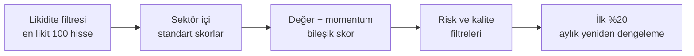
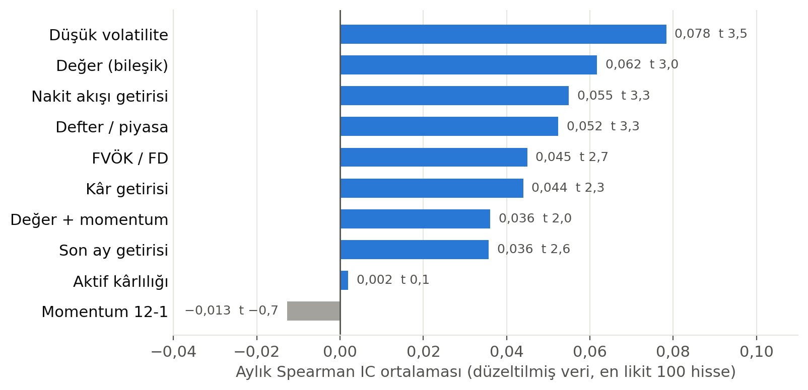
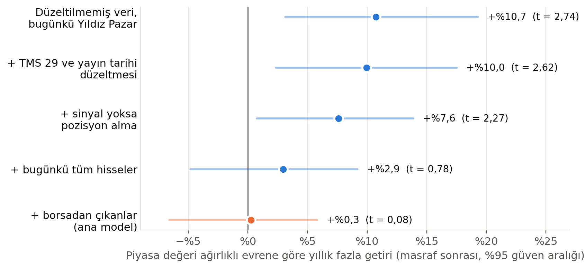

# BIST Çok Faktörlü Hisse Seçim Modeli

## Özet

Bu çalışmada Borsa İstanbul hisseleri için finansal tablo ve piyasa verisine dayanan çok faktörlü bir hisse seçim modeli geliştirilmiş ve 10 yıllık bir dönemde işlem maliyetleri dahil edilerek sınanmıştır. Model her ay şirketleri değer, momentum, kalite ve risk özelliklerine göre puanlayarak en yüksek puanlı hisselerden portföy oluşturmaktadır. Değer ve düşük volatilite sinyallerinin sonraki ay getirisini istatistiksel olarak anlamlı biçimde öngördüğü bulunmuştur. Çalışma sırasında veri setindeki ileriye bakma ve hayatta kalma yanlılıkları tespit edilerek düzeltilmiştir.

## Veri

| Kaynak | Kapsam |
|---|---|
| İş Yatırım mali tabloları | Bilanço, gelir tablosu ve nakit akış tablosu |
| Kamuyu Aydınlatma Platformu (KAP) | Finansal raporların yayın tarihleri |
| İş Yatırım piyasa verisi | Günlük fiyat, işlem hacmi ve piyasa değeri |
| Borsa İstanbul | Pazar ve sektör sınıflandırmaları, işlem sırası kapanan şirketler |
| TÜİK | Tüketici fiyat endeksi (TMS 29 düzeltmesi için) |

Bankalar, katılım bankaları, sigorta şirketleri, holdingler, gayrimenkul yatırım ortaklıkları ve sanayi şirketleri farklı finansal tablo yapılarına sahip olduğundan, her grup için ayrı bir kalem eşleme profili tanımlanmıştır. Veri seti *point-in-time* ilkesine göre kurulmuştur: her ay yalnızca o tarih itibarıyla kamuya açıklanmış bilgi kullanılmaktadır. Borsadan çıkan 74 şirket (52 kotasyondan çıkma, 19 birleşme, 3 iflas) evrene eklenmiş, finansal raporların yayın tarihlerinin %97,1'i KAP kayıtlarıyla eşleştirilmiştir.

## Faktörler

Yedi faktör ailesi altında 43 metrik hesaplanmaktadır.

| Faktör ailesi | Ölçtüğü özellik | Örnek metrikler |
|---|---|---|
| Değer | Piyasa fiyatının temel büyüklüklere göre düzeyi | FVÖK / firma değeri, kâr getirisi, defter değeri / piyasa değeri, nakit akışı getirisi |
| Kalite | Sermayenin verimli kullanımı | Özkaynak kârlılığı, aktif kârlılığı, yatırılan sermaye getirisi, brüt kârlılık |
| Kârlılık | Faaliyet marjları | Brüt, faaliyet ve net kâr marjları |
| Büyüme | Faaliyet büyüklüklerindeki yıllık değişim | Satış, FVÖK ve net kâr büyümesi |
| Yatırım | Bilanço genişlemesinin hızı | Aktif büyümesi, stok ve alacak büyümesinin satış büyümesinden farkı |
| Borçluluk | Finansal kaldıraç ve borç ödeme gücü | Net borç / FAVÖK, borç / özkaynak, faiz karşılama oranı |
| İstikrar | Finansal sonuçların dönemler arası oynaklığı | Marj, kâr ve yatırılan sermaye getirisi oynaklığı |

Bunlara ek olarak fiyat verisinden iki sinyal türetilmektedir: son ay hariç 12 aylık getiri (momentum 12-1) ve son bir yıllık günlük getirilerin standart sapması (düşük volatilite). Bankalar için takipteki krediler oranı ve kredi / mevduat oranı, sigorta şirketleri için birleşik rasyo gibi sektöre özgü metrikler de tanımlanmıştır.

## Yöntem



Portföy modeli, sonuçlar incelenmeden önce sabitlenen bir kural setine dayanmaktadır:

- Değer skoru, dört değer metriğinin sektör içi sıra skorlarının ortalamasıdır. Böylece farklı sektörlerdeki şirketlerin değerleme düzeyleri doğrudan karşılaştırılmamaktadır.
- Bileşik skor, değer ve momentum 12-1 skorlarının eşit ağırlıklı ortalamasıdır.
- Volatilitesi ve son bir aydaki en yüksek günlük getirisi en üst %10'da kalan hisseler, negatif özkaynaklı şirketler ve aktif kârlılığı en düşük %10'daki şirketler portföye alınmamaktadır.
- Portföye alınan hisse, sıralamada ilk %40'ın dışına çıkana kadar tutulmaktadır. Bu kural işlem sıklığını azaltmaktadır.
- Tek yönlü işlem maliyeti %0,3'tür. Kıyas ölçütü, piyasa değeri ağırlıklı evren getirisidir.

## Bulgular

Sinyallerin öngörü gücü bilgi katsayısıyla (*information coefficient*, IC) ölçülmüştür. IC, her ay hisselerin sinyal değerine göre sıralaması ile sonraki ay getirisine göre sıralaması arasındaki Spearman korelasyonudur. Düşük volatilite (IC = 0,078; t = 3,49) ve değer bileşik skoru (IC = 0,062; t = 3,05) anlamlı bulunmuştur. Momentum 12-1 sinyali için anlamlı bir ilişki gözlenmemiştir (IC = −0,013).



Değer ve momentum portföyü dönem boyunca yıllık %32,3 TL getiri sağlamıştır (kıyas ölçütü: %32,5). Yalnızca değer skoruna dayanan varyant, kıyas ölçütünü yıllık %4,2 geride bırakmıştır.

Çalışma sırasında veri setindeki üç yanlılık kaynağı tespit edilmiş ve düzeltilmiştir:

- Veri sağlayıcısının geçmiş dönem rakamlarını TMS 29 kapsamında yeniden düzenlenmiş değerlerle güncellemesi (ileriye bakma yanlılığı).
- Raporların yayın tarihinin sabit bir gecikmeyle varsayılması.
- Bugünkü pazar listesinin geçmişe uygulanması (hayatta kalma yanlılığı).

Grafik, her düzeltmenin backtest sonucunu nasıl değiştirdiğini göstermektedir. Düzeltilmemiş veri, aynı kural seti için yıllık %10,7'lik yanıltıcı bir fazla getiri üretmektedir.



## Uygulama

Kod Python ile yazılmıştır (pandas, NumPy, SciPy). Veri hattı, faktör hesaplamaları ve portföy simülasyonu 171 birim testiyle doğrulanmaktadır.

```bash
pip install -r requirements.txt
PYTHONPATH=. python -m unittest discover -s tests
```

Veri indirme adımları, tüm sonuç tabloları ve duyarlılık analizleri [`docs/AYRINTILAR.md`](docs/AYRINTILAR.md) dosyasında yer almaktadır. Ana rapor: [`reports/PIT_Model_Raporu.md`](reports/PIT_Model_Raporu.md).

## Sınırlılıklar

- Düzeltilmiş veride değer ve momentum portföyünün kıyas ölçütüne göre farkı yıllık +%0,3'tür ve istatistiksel olarak anlamlı değildir (t = 0,08). Yalnızca değer varyantının farkı da anlamlılık düzeyine ulaşmamıştır (t = 1,34).
- Momentum 12-1 sinyali getiriyle anlamlı bir ilişki göstermemiştir (IC = −0,013).
- İşlem sırası kapanan şirketlerin geçmişte hangi pazarda yer aldığı bilinmediğinden evrenin tamlığı yaklaşık %95 olarak tahmin edilmektedir.
- TMS 29 geçiş döneminde (2023-03 – 2024-03) bazı nominal değerler geri getirilemediğinden model 13 ay faktör pozisyonu almamıştır. Nakit akışı kalemlerinde düzeltme oranı %82'dir.
- Tüm dönem araştırma sırasında incelendiğinden ayrı bir saklama dönemi yoktur; açığa satış, vergi ve piyasa etkisi modellenmemiştir.

*Kodlamada Claude Code yardımcı araç olarak kullanılmıştır. Bu çalışma yatırım tavsiyesi niteliği taşımaz. Kod MIT lisansı ile paylaşılmaktadır.*
